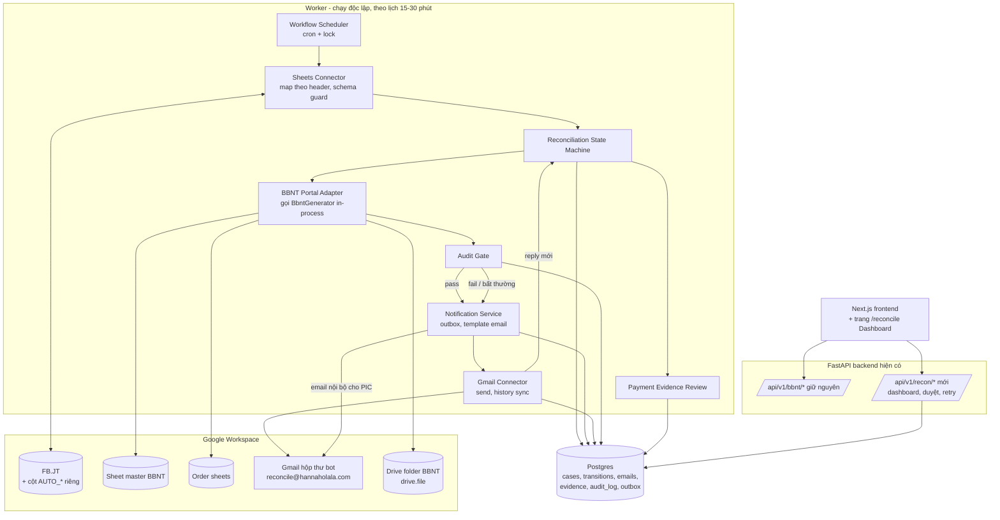
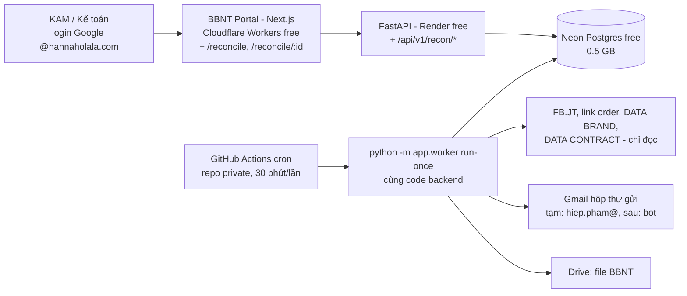
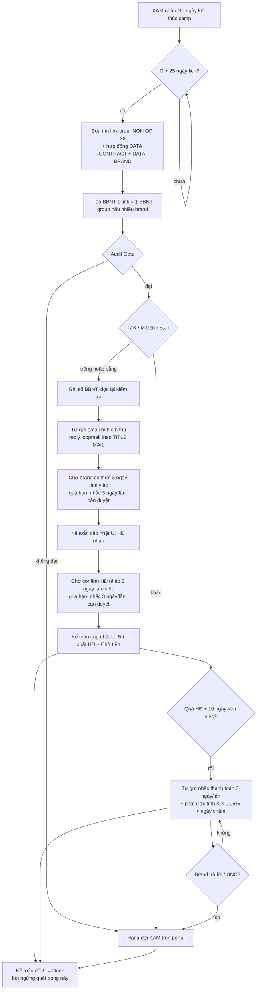

# Hannah Reconciliation Automation — Audit & Kiến trúc đề xuất

Ngày audit: 27/10/2026 · Phạm vi: chỉ đọc. Không sửa code, không ghi Sheet, không gửi email.

Nguồn đã đọc:
- Repo `hieppham-source/bbnt-portal` (branch `main`, commit `be77c42`), clone ẩn danh, chạy test backend tại sandbox: **494 passed, 1 skipped**.
- FB.JT (`1eIX6G9-…MWwHk`): danh sách tab, header `FB-2026` (dòng 6), cột Status, header `REMINDER LOG`. Chỉ đọc.
- Skill `hannaholala-reconciliation-reminder` (mô tả quy trình S1–S5 hiện tại).

---

## 0. Phát hiện quan trọng (đọc trước)

| # | Phát hiện | Hệ quả |
|---|---|---|
| F1 | **Không có trạng thái "Close camp"** trong cột `Status` (U) của `FB-2026`. Giá trị thực tế: `Brand chưa gửi data`, `Đã Confirm số + Chờ brand gửi BBNT`, `Đã có BBNT + Chờ Admin Check`, `Đã done BBNT + Chờ KT xuất HĐ nháp`, `Đã done BBNT + chờ brand gửi bản cứng BBNT`, `Đã xuất hóa đơn nháp + Chờ Brand confirm`, `Đã xuất hóa đơn + Chờ tiền`, `Done trả tiền`, `Done`, trống. | Chưa xác định được trigger. Cần anh chỉ rõ "Close camp" nằm ở cột/tab nào. |
| F2 | **Không thấy cột link order sheet** trong `FB-2026` (A→AE), ô CAMPAIGN/TITLE MAIL không có hyperlink. | Chưa tự động lấy được input cho BBNT. Cần xác nhận vị trí link. |
| F3 | **Skill reminder đang map lệch 1 cột** so với Sheet thật: Skill ghi G=OP, T=Status; header thực tế là E=`Ngày bắt đầu camp`, F=`BÊN B`, G=`Ngày kết thúc camp`, **H=OP**, **U=Status**, và có **2 cột tên `Status`** (U và Y). | Mọi connector phải map theo **tên header + kiểm tra schema mỗi lần chạy**, không hard-code chữ cột. Skill cần rà lại. |
| F4 | Cột `Ngày cập nhật status` (R) có **cùng một timestamp `17/10/2026 17:22:49` trên rất nhiều dòng**. | Không dùng được làm mốc phát hiện thay đổi hay tính hạn; phải tự lưu thời điểm phát hiện. |
| F5 | Nhiều dòng là **"GỘP LINE xxxx"** (ghi chú tự do ở NOTES): nhiều dòng FB.JT → 1 BBNT/1 HĐ. Không có ID dòng ổn định. | Đơn vị xử lý phải là **Reconciliation Case** (nhóm dòng), không phải 1 dòng. Cần cột ID + cột nhóm có cấu trúc. |
| F6 | Backend **stateless, không DB, không service account**; mọi lệnh gọi Google dùng **token của người đang đăng nhập**. | Không chạy được tác vụ nền (scheduler) bằng kiến trúc hiện tại. Cần credential không người dùng + kho trạng thái. |
| F7 | Số BBNT **tất định theo tháng lập** (`MM.YY` lấy từ thời điểm generate). | Generate lại ở tháng khác → số khác. Worker phải lưu `issued_at` và truyền clock cố định khi tạo lại. |
| F8 | Repo clone được **không cần đăng nhập** → nhiều khả năng là **public**. | Không được đặt worker trên GitHub Actions của repo public (log công khai), không commit secret/dữ liệu brand. |

---

## 1. Kiến trúc hiện tại

```mermaid
flowchart LR
  U[Nhân viên @hannaholala.com] -->|Google OAuth: openid, email,<br/>spreadsheets.readonly, drive.readonly| FE
  subgraph CF[Cloudflare Workers - free]
    FE[Next.js 15 + Auth.js v5<br/>BbntForm, MasterCheck<br/>JWT session 8h, refresh token]
  end
  FE -->|Bearer ID token +<br/>X-Google-Access-Token| BE
  subgraph R[Render free - Docker, Singapore]
    BE[FastAPI - stateless<br/>/api/v1/master, /master/check<br/>/api/v1/bbnt/preview, /preview-split, /generate]
    T[(templates/*.docx<br/>EZS, Sassy FB NON-OP)]
  end
  BE -->|Sheets API bằng token người dùng| MS[(Google Sheet MASTER<br/>pháp nhân, brand, HĐ, mapping)]
  BE -->|Sheets/Drive API| OS[(Order sheet / .xlsx<br/>link do người dùng dán)]
  BE --> T
  BE -->|.docx stream về trình duyệt<br/>không lưu| FE
  GH[GitHub Actions backend-ci<br/>ruff, mypy strict, pytest] -->|checksPass| R
  K[Kế toán / KAM] -. cập nhật tay .-> FBJT[(FB.JT Google Sheet)]
  SK[Claude skill reminder] -. đọc FB.JT, soạn/gửi mail .-> GM[Gmail]
```

### 1.1 Audit chi tiết

| Hạng mục | Hiện trạng |
|---|---|
| Frontend | Next.js 15.5, React 19, next-auth 5 beta, TypeScript. 2 trang: `/` (form tạo BBNT, `BbntForm.tsx` ~1.1k dòng), `/master` (kiểm tra master). Deploy tay `npm run cf:deploy` (OpenNext Cloudflare). |
| Backend | Python 3.12, FastAPI, pydantic v2, python-docx + lxml (điền template OOXML), openpyxl, google-auth, requests. Không ORM, không DB. |
| Lõi nghiệp vụ tái sử dụng được | `core/calculation.py` (parse order, NMV chỉ đơn "Đã giao", hoa hồng, VAT/khấu trừ, `reconcile()`), `core/numbering.py` (số BBNT), `services/generator.py` (`BbntGenerator.run / run_split`, clock inject được), `services/sheets.py` (`GoogleSheetsReader.from_access_token`, đọc Sheet + .xlsx Drive), `services/order_tabs.py`, `docx/filler.py`, `master/*` (loader + cache 60s), `cli.py` (`check`, `generate` chạy không cần web). |
| API hiện có | `GET /`, `/healthz`, `/readyz`; `GET /api/v1/master`, `GET /api/v1/master/check`; `POST /api/v1/bbnt/preview`, `POST /api/v1/bbnt/preview-split`, `POST /api/v1/bbnt/generate` (trả .docx + header `X-BBNT-Number`, `X-BBNT-Total-Payable`, `X-BBNT-Warnings`). |
| **Đã có API tạo BBNT chưa?** | **Có**, nhưng chỉ dùng được khi có người dùng đăng nhập (cần ID token + access token Google của người đó). Input phải do người làm chọn tay: `entity`, `brand_codes/group_code`, `contract_no`, `bbnt_suffix`, `campaign_name`, `order_sheet_url`, tab/breakdown. |
| Database | Không có. Master data = Google Sheet master. BBNT không lưu. |
| File & template | Template `.docx` versioned trong `backend/templates/` (`bbnt_ezs_fb_nonop.v2.docx`, `bbnt_sassy_fb_nonop.v2.docx`) + bản gốc `templates/source/`. Có cơ chế chặn khi câu chữ pháp lý bị sửa (`LegalTextModifiedError`). Chỉ có template **FB NON-OP**. |
| Xác thực | Google ID token verify bằng cert Google (aud, iss, exp, email_verified, domain `hd`); access token verify qua tokeninfo (đúng app, đúng người, có scope). CORS khoá origin, Swagger tắt ở production. |
| Secret | Frontend: `AUTH_SECRET`, `AUTH_GOOGLE_ID/SECRET` (Cloudflare secrets). Backend: chỉ `GOOGLE_OAUTH_CLIENT_ID`, `MASTER_SHEET_URL` (Render env). Không có secret cho tác vụ nền. |
| Deploy | Backend: Render Blueprint, free plan (ngủ khi không có traffic, 512MB, disk tạm), auto-deploy khi CI xanh. Frontend: Cloudflare Workers, deploy tay từ máy Windows (lưu ý `chcp 65001`). |
| Test | 494 test pass. CI: ruff + mypy strict + pytest. |
| Điểm yếu cho automation | Không DB; không credential nền; Render free ngủ (cold start ~50s); generator gắn với token người dùng qua FastAPI deps; đầu vào BBNT đòi chọn tay (hợp đồng, đuôi số). |

---

## 2. Kiến trúc đề xuất

Nguyên tắc: **giữ một backend Python duy nhất**, worker chạy **cùng codebase** (import trực tiếp `BbntGenerator`, như `cli.py` đang làm), thêm **một Postgres** làm kho trạng thái, và **một tài khoản bot Workspace** làm danh tính nền. FB.JT vẫn là nơi người dùng làm việc; hệ thống chỉ ghi vào **các cột riêng của automation**.



### 2.1 Module

| Module | Vai trò | Thực hiện trong codebase |
|---|---|---|
| Google Sheets Connector | Đọc FB.JT theo **tên header** (xử lý cột trùng tên `Status`), kiểm tra schema mỗi lần chạy (thiếu/đổi header → dừng + báo), đọc order sheet, ghi **chỉ** cột AUTO_* với kiểm tra giá trị cũ trước khi ghi. | Mở rộng `services/sheets.py` (đã có reader) + thêm writer `services/fbjt.py`. |
| Gmail Connector | Gửi mail mới/reply đúng thread (`threadId` + `In-Reply-To`/`References`), lưu `gmail_message_id`, `thread_id`, `rfc822_message_id`; đồng bộ thư đến bằng `users.history.list` từ `historyId` đã lưu (polling, không cần Pub/Sub). | Mới: `integrations/gmail.py`. |
| BBNT Portal Adapter | Dựng `BbntInput` từ Case, gọi `BbntGenerator.run(render=False)` để audit, rồi `render=True` để xuất file; cố định clock = `issued_at` đã lưu; lưu .docx vào Drive folder + checksum. **Không** đổi công thức/template. | Mới: `services/bbnt_job.py` (bọc generator, không viết lại). |
| Workflow Scheduler | Chạy theo lịch, mỗi lần: scan Sheet → sync Gmail → tiến state → gửi outbox. Lock toàn cục (Postgres advisory lock) chống chạy chồng. | Mới: `python -m app.worker run-once` (lệnh CLI, giống `app.cli`). |
| Reconciliation State Machine | Bảng chuyển trạng thái tường minh, mỗi chuyển có điều kiện + nguồn bằng chứng; transition ghi DB trong transaction; không có chuyển "ngầm". | Mới: `recon/state_machine.py` (thuần, test dễ). |
| Audit Gate | Quyết định "tự gửi" hay "chuyển người". Chặn khi: có ERROR từ generator; `manual_contract=True`; số liệu lệch FB.JT (NMV/commission) quá ngưỡng; thiếu email người nhận; brand OP; status chưa cấu hình; thread không xác định; trùng lần gửi trong chu kỳ. | Mới: `recon/audit_gate.py`, ngưỡng cấu hình trong DB. |
| Notification Service | Outbox pattern: ghi hàng đợi có `idempotency_key` trước khi gửi; template email versioned (**nội dung do anh duyệt**); email nội bộ báo PIC khi có case bất thường. | Mới: `recon/notify.py` + bảng `email_outbox`, `email_templates`. |
| Payment Evidence Review | Nhận email có UNC (PDF/ảnh) trong thread, lưu bằng chứng, trích số tiền/số tham chiếu nếu đọc được, **luôn cần kế toán xác nhận** trước khi coi là đã thu. | Mới: `recon/evidence.py` + bảng `payment_evidence`. |
| Audit Log | Append-only: ai/cái gì đổi gì, giá trị cũ → mới, nguồn (worker/user/sheet). | Bảng `audit_log`, không UPDATE/DELETE. |
| Dashboard | Danh sách case theo trạng thái, hàng đợi cần duyệt, lịch sử email/thread, nút Duyệt gửi / Giữ / Retry / Đánh dấu bằng chứng hợp lệ. | Thêm trang `/reconcile` vào Next.js hiện có, dùng login Google sẵn có. |

### 2.2 Chạy worker ở đâu (đơn giản, độc lập Claude Code)

| Phương án | Ưu | Nhược | Đề xuất |
|---|---|---|---|
| **A. Cloud Run Job + Cloud Scheduler** (GCP) | Không ngủ, chạy job theo lịch, dùng service account **không cần key** (identity gắn sẵn). | Cần project GCP + billing (thường nằm trong free tier). | **Ưu tiên** nếu được cấp project GCP. Cũng giải quyết luôn F6. |
| B. GitHub Actions cron gọi `python -m app.worker run-once` | Free, đã dùng cho CI, cùng code. | Repo public → log công khai, cron có thể trễ; secret là refresh token. | Chỉ dùng nếu chuyển repo sang **private**. |
| C. Cloudflare Cron Trigger gọi endpoint Render | Free. | Render free ngủ, request dài dễ timeout, khó retry. | Không đề xuất. |

Kho trạng thái: **Postgres managed free tier** (Neon hoặc Supabase). Lý do không dùng Sheet làm DB: cần transaction, unique constraint chống gửi trùng, lock, lịch sử bất biến. FB.JT vẫn là giao diện chính của người dùng; tab `REMINDER LOG` có thể tiếp tục được ghi song song để người không vào Dashboard vẫn thấy.

### 2.3 Phát hiện thay đổi

1. **Polling** FB.JT mỗi 15–30 phút bằng `values.batchGet` (1 lệnh/lần, nhẹ quota). Không dùng Drive push (chỉ báo "file đổi", cần webhook, hết hạn).
2. **ID dòng ổn định**: thêm cột `AUTO_ID` (đề xuất, cần duyệt). Worker gán UUID cho dòng mới chưa có ID — đây là lần ghi duy nhất vào dòng, và chỉ vào ô trống. Không có ID → dùng khoá tự nhiên tạm (Month+GROUP+BRAND+CAMPAIGN+BÊN B) và chỉ đọc, không hành động.
3. **Snapshot**: lưu hash các cột liên quan của từng dòng (`sheet_row_snapshot`). Lần scan sau so hash → sinh `sheet_change_event` (cũ → mới). Trigger "Close camp" = event chuyển sang giá trị đã cấu hình (chờ F1).
4. **Chống xử lý trùng**: unique `(case_id, step, cycle_no)` ở `email_outbox`; transition chỉ chạy nếu `from_state` khớp (optimistic lock `version`).
5. **Retry**: lỗi tạm (5xx, 429, timeout) → backoff 1/5/30 phút, tối đa N lần, sau đó `ERROR` + báo PIC. Lỗi vĩnh viễn (403, schema sai) → dừng ngay, không retry.
6. **Sheet không truy cập được**: FB.JT lỗi → **dừng toàn bộ chu kỳ** (không gửi gì dựa trên dữ liệu cũ) + cảnh báo. Order sheet lỗi → case sang `MANUAL_REVIEW` với lý do `ORDER_SHEET_UNREADABLE` (mã lỗi đã có trong backend).
7. **Không ghi đè người dùng**: (a) chỉ ghi cột AUTO_*; (b) trước khi ghi, đọc lại ô và so với giá trị đã thấy, khác → bỏ ghi + log conflict; (c) **không bao giờ** tự sửa cột `Status` của kế toán ở Phase đầu — chỉ ghi `AUTO_SUGGESTED_STATUS` để người xác nhận.

### 2.4 Phân biệt email xác nhận hợp lệ

Một reply chỉ được coi là **bằng chứng ứng viên** khi qua đủ các lớp; trạng thái "đã xác nhận" luôn cần người duyệt ở Phase 1–3:

1. Thuộc đúng thread đã lưu cho case **và** đến sau email yêu cầu của mình.
2. Người gửi nằm trong danh sách liên hệ hợp lệ của brand (từ DATA BRAND/CONTACT LIST — cần xác nhận nguồn chuẩn), không phải địa chỉ nội bộ, không phải bot.
3. Header xác thực: `Authentication-Results` có DKIM/SPF/DMARC pass cho domain người gửi.
4. Loại thư tự động: `Auto-Submitted`, `X-Autoreply`, `Precedence: bulk/auto_reply`, NDR/bounce, thông báo đọc thư, out-of-office.
5. Nội dung: phân loại `CONFIRM / REJECT / QUESTION / INFO / OOO` bằng luật + (tuỳ chọn) mô hình; **câu chữ xác nhận cụ thể do anh định nghĩa**, không tự đặt.
6. Với BBNT/hóa đơn/UNC: phải có **file đính kèm** đúng loại; lưu hash file làm bằng chứng.
7. Case có nhiều campaign trong một thread → phải map được reply vào đúng case, nếu mơ hồ → `MANUAL_REVIEW`.

---

## 3. File/module cần sửa hoặc bổ sung

Sửa (tối thiểu, không đổi hành vi hiện tại):

| File | Thay đổi |
|---|---|
| `backend/app/config.py` | Thêm cấu hình `DATABASE_URL`, `RECON_*` (bật/tắt từng tính năng, chế độ dry-run), chỉ bắt buộc khi bật worker. |
| `backend/app/main.py` | `include_router(recon_router)`. |
| `backend/app/api/deps.py` | Dependency cho DB session + kiểm tra quyền (role reviewer). |
| `backend/requirements.txt` | Thêm `psycopg[binary]`, `SQLAlchemy` (hoặc chỉ psycopg + SQL thuần), `alembic` cho migration. |
| `render.yaml`, `.github/workflows/backend-ci.yml` | Env mới; CI chạy migration test với Postgres service container. |
| `frontend/app/` + `frontend/lib/api.ts` | Trang `/reconcile` và client API mới. |

Thêm mới:

```
backend/app/
  db/            session.py, models.py, migrations/ (alembic)
  integrations/  google_bot.py (credential nền), gmail.py
  services/      fbjt.py (đọc/ghi FB.JT theo header), bbnt_job.py (bọc BbntGenerator)
  recon/         state_machine.py, audit_gate.py, notify.py, evidence.py, rules.py (map case → BbntInput)
  api/v1/recon.py
  worker.py      (python -m app.worker run-once | dry-run | backfill)
backend/tests/recon/  test_state_machine.py, test_audit_gate.py, test_fbjt_mapping.py, test_gmail_classify.py, test_outbox_idempotency.py
frontend/app/reconcile/  page.tsx, [caseId]/page.tsx
```

Không động vào: `core/calculation.py`, `core/numbering.py`, `docx/*`, `templates/*` (chỉ gọi lại).

---

## 4. API cần bổ sung

Tất cả dưới `/api/v1/recon`, xác thực bằng Google ID token như hiện tại + kiểm tra role.

| Method | Path | Mục đích |
|---|---|---|
| GET | `/cases?state=&brand=&pic=` | Danh sách case cho Dashboard. |
| GET | `/cases/{id}` | Chi tiết: dòng FB.JT, BBNT preview, transitions, emails, evidence. |
| POST | `/cases/{id}/bbnt/preview` | Chạy lại `BbntGenerator.run(render=False)` cho case (dùng token bot). |
| POST | `/cases/{id}/approve-send` | Người duyệt cho phép gửi email đang chờ. |
| POST | `/cases/{id}/hold` · `/resume` | Tạm giữ/tiếp tục (có lý do). |
| POST | `/cases/{id}/retry` | Thử lại bước lỗi. |
| POST | `/evidence/{id}/verify` | Kế toán xác nhận/bác bỏ bằng chứng (xác nhận số liệu, BBNT ký, UNC). |
| GET | `/runs` · `/runs/{id}` | Lịch sử chạy worker, lỗi, số dòng quét. |
| GET | `/health/integrations` | Trạng thái token bot, quyền FB.JT, Gmail, schema FB.JT. |

**API tạo BBNT tối thiểu**: không cần endpoint tạo BBNT mới — worker gọi in-process `services/bbnt_job.py`, và `bbnt_job` chỉ gọi `BbntGenerator` hiện có. Endpoint `/cases/{id}/bbnt/preview` là lớp mỏng cho Dashboard. Ba endpoint `/api/v1/bbnt/*` hiện tại giữ nguyên.

---

## 5. Database schema đề xuất (Postgres)

```sql
-- Một case = một BBNT dự kiến (có thể gồm nhiều dòng FB.JT "gộp line")
create table recon_case (
  id uuid primary key,
  case_key text unique not null,          -- khoá nghiệp vụ, cách dựng chờ xác nhận
  channel text not null,                  -- FB
  entity_code text,                       -- EZS | SASSY
  group_code text, brand_codes text[],
  campaign_label text,
  op_flag text,                           -- giá trị gốc cột OP
  state text not null,
  state_version int not null default 0,   -- optimistic lock
  hold_reason text,
  pic_email text,
  gmail_thread_id text,
  bbnt_number text, bbnt_issued_at timestamptz, bbnt_file_id text, bbnt_sha256 text,
  figures jsonb,                          -- NMV, commission, total_payable từ generator
  created_at timestamptz not null default now(),
  updated_at timestamptz not null default now()
);

create table sheet_row (                   -- liên kết dòng FB.JT <-> case
  auto_id text primary key,                -- giá trị cột AUTO_ID
  spreadsheet_id text not null, tab text not null,
  last_row_number int, case_id uuid references recon_case(id),
  last_hash text, last_values jsonb, last_seen_at timestamptz
);

create table sheet_change_event (
  id bigserial primary key, auto_id text references sheet_row(auto_id),
  column_name text, old_value text, new_value text,
  detected_at timestamptz not null default now(), run_id uuid
);

create table state_transition (
  id bigserial primary key, case_id uuid not null references recon_case(id),
  from_state text, to_state text not null,
  trigger text not null,                   -- sheet_change | email | user | worker
  actor text not null, evidence_id uuid, reason text,
  at timestamptz not null default now()
);

create table email_outbox (
  id uuid primary key, case_id uuid references recon_case(id),
  step text not null, cycle_no int not null,
  idempotency_key text unique not null,    -- case_id:step:cycle_no
  template_code text not null, template_version int not null,
  to_addrs text[] not null, cc_addrs text[],
  subject text not null, body_html text not null, attachments jsonb,
  reply_to_thread_id text,
  status text not null,                    -- PENDING_REVIEW | QUEUED | SENDING | SENT | FAILED | CANCELLED
  approved_by text, approved_at timestamptz,
  attempts int not null default 0, last_error text,
  created_at timestamptz not null default now(),
  unique (case_id, step, cycle_no)
);

create table email_message (               -- mọi thư gửi/nhận liên quan case
  gmail_message_id text primary key, gmail_thread_id text not null,
  rfc822_message_id text, case_id uuid references recon_case(id),
  direction text not null,                 -- OUT | IN
  from_addr text, to_addrs text[], sent_at timestamptz,
  auth_results jsonb, is_auto_reply bool,
  classification text, classification_confidence numeric,
  outbox_id uuid references email_outbox(id)
);

create table evidence (
  id uuid primary key, case_id uuid references recon_case(id),
  kind text not null,                      -- FIGURES_CONFIRM | SIGNED_BBNT | INVOICE_DRAFT_CONFIRM | PAYMENT_UNC
  gmail_message_id text references email_message(gmail_message_id),
  file_name text, file_sha256 text, drive_file_id text,
  extracted jsonb,                         -- số tiền, số tham chiếu nếu đọc được
  review_status text not null default 'PENDING', -- PENDING | ACCEPTED | REJECTED
  reviewed_by text, reviewed_at timestamptz, review_note text
);

create table worker_run (
  id uuid primary key, started_at timestamptz, finished_at timestamptz,
  status text, rows_scanned int, events int, emails_sent int, error text
);

create table audit_log (                   -- append-only (REVOKE UPDATE, DELETE)
  id bigserial primary key, at timestamptz not null default now(),
  actor text not null, action text not null, entity text, entity_id text,
  before jsonb, after jsonb, run_id uuid
);

create table gmail_sync_state (mailbox text primary key, history_id text, updated_at timestamptz);
create table email_template (code text, version int, subject text, body_html text, approved_by text,
  primary key (code, version));
```

Trạng thái nội bộ (tên tạm, ánh xạ sang Status FB.JT chờ xác nhận):
`DETECTED → BBNT_DRAFTED → AUDIT_PASSED | MANUAL_REVIEW → EMAIL_SENT → AWAITING_BRAND_CONFIRM → BRAND_CONFIRMED* → AWAITING_SIGNED_BBNT → BBNT_SIGNED* → AWAITING_INVOICE (kế toán) → INVOICE_DRAFT_SENT → INVOICE_CONFIRMED* → INVOICE_ISSUED → AWAITING_PAYMENT → PAYMENT_EVIDENCE_RECEIVED → PAID*`, cộng `ON_HOLD`, `ERROR`, `CANCELLED`, `EXCLUDED_OP`.
(*) = cần người xác nhận.

---

## 6. Quyền Google cần cấp

Danh tính nền: **một tài khoản Workspace riêng** (ví dụ `reconcile@hannaholala.com`, tên do anh chọn). Least privilege đạt bằng **chia sẻ đúng file cho tài khoản này**, không cấp domain-wide delegation.

| Mục đích | Scope | Ghi chú |
|---|---|---|
| Đọc FB.JT, master, order sheet; ghi cột AUTO_* trên FB.JT | `https://www.googleapis.com/auth/spreadsheets` | Sheets không có scope theo file. Giới hạn bằng chia sẻ: FB.JT = **Editor**, master + order = **Viewer**. Có thể bảo vệ (Protected range) các cột người dùng để bot không ghi được dù có lỗi. |
| Đọc order dạng .xlsx trên Drive | `drive.readonly` | Như portal hiện tại. Có thể thay bằng `drive.file` nếu order luôn là Google Sheet. |
| Lưu file BBNT đã tạo | `drive.file` | Chỉ thấy file/thư mục do app tạo. |
| Gửi email | `gmail.send` | |
| Đọc thread phản hồi | `gmail.readonly` | Chỉ hộp thư bot. Không cần `gmail.modify` trừ khi muốn gắn nhãn. |

Lấy credential nền — 2 cách, tuỳ quyền admin:

1. **Cloud Run + service account không key** (phương án A): service account chỉ đọc/ghi Sheet được chia sẻ cho nó; **Gmail của user thì service account không gửi được nếu không có domain-wide delegation** → vẫn cần cách 2 cho Gmail, hoặc admin cấp DWD giới hạn đúng 2 scope Gmail cho đúng 1 hộp thư.
2. **OAuth refresh token của tài khoản bot**: OAuth client loại **Internal** (chỉ trong hannaholala.com, không cần Google verification cho scope Gmail), cấp 1 lần, lưu refresh token trong Secret Manager/secret của nơi chạy worker. Đơn giản nhất, phù hợp việc anh không tạo được key service account.

Không dùng hộp thư cá nhân của KAM/kế toán làm danh tính gửi tự động.

---

## 7. Rủi ro

Kỹ thuật:

| Rủi ro | Giảm thiểu |
|---|---|
| FB.JT đổi cột/thêm cột (đã xảy ra, F3) | Map theo header, schema guard dừng chu kỳ khi lệch, test với snapshot header. |
| Không có ID dòng; sort/chèn dòng làm lệch | Cột `AUTO_ID`; không bao giờ dùng số dòng làm khoá. |
| Gửi trùng do crash giữa "gửi" và "ghi DB" | Outbox + idempotency key; trước khi gửi lại, tìm trong Sent theo `rfc822msgid:` đã đặt sẵn (cần kiểm chứng Gmail giữ Message-ID ở Phase 0). |
| Reply sai thread / thread nhiều campaign | Lưu `thread_id` từ lần gửi đầu; reply mơ hồ → MANUAL_REVIEW. |
| Số BBNT đổi khi tạo lại sang tháng khác (F7) | Lưu `bbnt_issued_at`, inject clock cố định. |
| Quota Google / token bot bị thu hồi | Batch đọc, backoff; `/health/integrations` + cảnh báo khi token lỗi. |
| Repo public (F8) | Chuyển private trước khi thêm code tích hợp; không log PII/số tiền ở nơi công khai. |
| Render free ngủ, disk tạm | Worker không chạy trên Render; DB managed. |
| Thêm hạ tầng (DB, nơi chạy worker) | Chọn dịch vụ managed free tier; migration có `downgrade`. |

Nghiệp vụ:

| Rủi ro | Giảm thiểu |
|---|---|
| Gửi email sai số liệu cho brand | Audit Gate; Phase 2 mọi email cần duyệt; chỉ bật tự gửi theo từng loại email sau khi tỉ lệ duyệt không sửa đạt ngưỡng. |
| Coi nhầm email thường/OOO là xác nhận | 7 lớp kiểm tra ở 2.4; xác nhận có giá trị pháp lý luôn cần người duyệt. |
| Dòng OP lọt vào luồng | Loại trừ ở bước đầu theo cột OP, test riêng. |
| Hợp đồng chưa có trong master (`manual_contract`) → hoa hồng 0 | Audit Gate chặn tuyệt đối. |
| "Gộp line" ghi tự do → nhóm sai | Cần cột nhóm có cấu trúc; nhóm không chắc chắn → MANUAL_REVIEW. |
| Kế toán và bot cùng sửa trạng thái | Bot không ghi cột của người; xung đột → log, không ghi đè. |
| Template email/subject chưa thống nhất | Template versioned, phải được duyệt mới dùng. |
| Brand thanh toán một phần, UNC không khớp | Evidence luôn qua kế toán; không tự đặt PAID. |

---

## 8. Kế hoạch triển khai theo phase

Mỗi phase có cờ bật/tắt (`RECON_ENABLED`, `RECON_SEND_MODE=off|review|auto`, `RECON_SHEET_WRITE=off|on`). Rollback mặc định = tắt cờ; dữ liệu FB.JT không bị ảnh hưởng vì chỉ có cột AUTO_*.

| Phase | Nội dung | Kiểm thử | Rollback |
|---|---|---|---|
| **0. Chuẩn bị** (không code production) | Trả lời mục 9; chuyển repo private; tạo tài khoản bot + OAuth Internal; tạo Postgres; tạo **bản sao FB.JT** để test; kiểm chứng Gmail giữ Message-ID. | Checklist. | Không có thay đổi production. |
| **1. Read-only shadow** | DB + migration; Sheets Connector (đọc), schema guard, snapshot, change event; `bbnt_job` chạy `render=False`; Dashboard chỉ đọc. Không ghi Sheet, không gửi mail. | Unit test mapping/state machine; chạy trên bản sao FB.JT; so kết quả preview với BBNT thật đã làm tay 1–2 tuần. | Tắt worker, `alembic downgrade`. |
| **2. Draft mode** | Gmail Connector gửi vào **Drafts** hoặc chỉ tạo outbox `PENDING_REVIEW`; Audit Gate; email nội bộ báo PIC. | Người duyệt so từng email; đo tỉ lệ phải sửa. | `RECON_SEND_MODE=off`, xoá drafts. |
| **3. Review-and-send** | Gửi thật sau khi người bấm duyệt; ghi `AUTO_*` lên FB.JT (chỉ ô trống/không xung đột); đồng bộ reply, phân loại, evidence chờ duyệt; ghi song song `REMINDER LOG`. | Test trên thread nội bộ trước, rồi 1–2 brand thí điểm. | `RECON_SEND_MODE=off`, `RECON_SHEET_WRITE=off`; cột AUTO_* có thể ẩn/xoá. |
| **4. Auto-send có kiểm soát** | Bật tự gửi **chỉ** cho loại email thường đã ổn định (ví dụ nhắc định kỳ) khi Audit Gate pass; mọi bất thường vẫn vào hàng đợi người. Giới hạn số email/brand/ngày. | Theo dõi 2 tuần, mỗi lần chạy có báo cáo. | Về `review`. |
| **5. Payment evidence & mở rộng** | Nhận diện UNC, gợi ý đối chiếu; mở rộng TTS/SHP và template OP nếu có. | Kế toán xác nhận 100% trong giai đoạn đầu. | Tắt module evidence. |

---

## 9. Thông tin cần anh xác nhận

FB.JT & trigger
1. "Close camp" được ghi ở đâu (cột nào, tab nào, giá trị chính xác)? Ai cập nhật (KAM)?
2. Link order sheet của từng campaign lưu ở đâu trong FB.JT (cột, tab, hay ghi chú)?
3. Tab nào là nguồn chính: chỉ `FB-2026`, hay cả `FB-2025` cho công nợ cũ? Năm sau có tạo tab mới không?
4. Có được thêm cột automation vào FB.JT (vd `AUTO_ID`, `AUTO_STATE`, `AUTO_SUGGESTED_STATUS`, `AUTO_LAST_ACTION`) ở bên phải không? Có được đặt Protected range cho các cột người dùng không?
5. Ý nghĩa của 2 cột tên `Status` (U và Y) và cột `BBNT Status` (Q); cột nào là nguồn chuẩn?
6. Cột `Ngày cập nhật status` được cập nhật thế nào (tay, công thức, script)? Vì nhiều dòng có cùng timestamp.
7. Quy tắc "gộp line": nhiều dòng thành 1 BBNT dựa vào đâu? Có thể thêm một cột nhóm có cấu trúc không?
8. Danh sách đầy đủ giá trị Status hợp lệ và thứ tự chuyển giữa chúng; status `Đã done BBNT + chờ brand gửi bản cứng BBNT` xử lý ra sao?

BBNT
9. Quy tắc lấy `entity`, `brand_codes/group_code`, `contract_no`, `bbnt_suffix`, `campaign_name` từ dòng FB.JT (hiện người làm chọn tay)?
10. Ngưỡng lệch cho phép giữa số liệu BBNT tính lại và cột NMV/COMMISSION trên FB.JT.
11. BBNT tạo ra lưu ở đâu (thư mục Drive nào), ai có quyền xem?
12. Brand OP và kênh TTS/SHP có thuộc phạm vi không (hiện chỉ có template FB NON-OP)?

Email
13. Template, subject, To/CC cho từng bước (anh cung cấp hoặc duyệt; skill hiện có một bộ, nhưng cần xác nhận còn đúng).
14. "Loopmail" là thread Gmail thông thường hay một Google Group/alias? Hộp thư nào là người gửi chính thức?
15. Thế nào là xác nhận hợp lệ cho: số liệu, BBNT, hóa đơn nháp, UNC (người gửi nào, cần file gì, câu chữ nào)?
16. Danh sách liên hệ hợp lệ của brand lấy từ `DATA BRAND` hay `CONTACT LIST`?
17. Loại email nào được tự gửi ở Phase 4; loại nào luôn cần duyệt?

Deadline & hóa đơn
18. Quy tắc deadline từng bước (đối soát, ký BBNT, xác nhận HĐ nháp, thanh toán) và chu kỳ nhắc.
19. Cách xác định hóa đơn đã xuất: cột nào, định dạng nào (hiện thấy cả `HĐ:` và `HD:`, có/không khoảng trắng).
20. Kế toán cập nhật "đã thu tiền" ở đâu (`Done trả tiền`, cột `Ngày nhận`, `Bank nhận tiền Comm`)?

Hạ tầng & quyền
21. Có được tạo tài khoản Workspace riêng cho bot và OAuth client Internal không? Admin có cấp domain-wide delegation giới hạn không?
22. Có project GCP (Cloud Run/Scheduler) không, hay chọn GitHub Actions (cần repo private)?
23. Đồng ý dùng Postgres managed (Neon/Supabase) không, hay có ràng buộc "không database"?
24. Ai được vai trò reviewer/approver trên Dashboard?

---

## 10. Cập nhật sau phản hồi (27/10/2026)

Đã đọc thêm (chỉ đọc): `DATA BRAND`, `DATA CONTRACT` (FB.JT) và file `[NEW] Các order link gửi brand` (tab `NON OP 26`).

### 10.1 Thay đổi thiết kế

| Chủ đề | Trước | Sau phản hồi |
|---|---|---|
| Trigger | Chờ status "Close camp" | **FB.JT cột G `Ngày kết thúc camp` có ngày** (KAM nhập). Ngày này là mốc follow nghiệm thu. |
| Nguồn | FB-2026 | Chỉ tab năm hiện tại (`FB-2026`). Tên tab lấy theo năm (`FB-{YYYY}`), header kiểm tra mỗi lần chạy. |
| Ghi vào FB.JT | Thêm cột `AUTO_*` | **Bot không thêm cột, không đặt luật, không sửa ô nào trong FB-2026.** Status (U) chỉ do người cập nhật. Bot chỉ đọc. |
| Status | U và Y | **Chỉ dùng cột U.** |
| Đơn vị xử lý | Nhóm "gộp line" | **1 link order = 1 BBNT = 1 case.** Một link có thể phủ nhiều dòng FB.JT (vd AMORE: AESTURA + INNISFREE cùng 1 link) → BBNT theo group. |
| Link order | Chưa biết | `NON OP 26` cột F, dạng **smart chip** (API `values.get` chỉ trả chữ hiển thị; phải dùng `spreadsheets.get` lấy `chipRuns.richLinkProperties.uri`). Nối với FB.JT bằng **(BRAND, CAMP)** ↔ **(BRAND, CAMPAIGN (KHỚP HARAVAN))**. Không khớp hoặc khớp nhiều dòng → chuyển người. |
| ID dòng | Cột `AUTO_ID` | Không có cột → khoá tự nhiên `(tab, BRAND, CAMPAIGN)` + spreadsheet ID của link order, lưu ở kho trạng thái. Trùng khoá → chuyển người, không đoán. |
| Số liệu | Ngưỡng lệch | **BBNT và FB.JT phải bằng nhau tuyệt đối.** Audit Gate: NMV/COMMISSION trên FB.JT khác số BBNT (hoặc đang trống) → chuyển KAM. |
| Thông tin BBNT | Chọn tay | Brand/group, pháp nhân, email, PIC từ `DATA BRAND`; số hợp đồng từ `DATA CONTRACT` (STATUS = "Đã ký"). Chỉ FB Non-OP (`DATA BRAND.OP` trống và FB.JT `OP` trống). |
| Lưu BBNT | Drive folder riêng | Tạo file trên Drive, gửi link trong loopmail. |
| Loopmail | Hộp thư bot riêng | Reply vào thread chính thức của **hộp thư EZS (hoặc anh)**. Lưu ý: Gmail API chỉ thấy thread **trong hộp thư của chính nó**, nên bot phải chạy bằng đúng hộp thư sở hữu loopmail. |
| Xác nhận hợp lệ | Chưa có | Reply trong loopmail, từ email trong `DATA BRAND.EMAIL BRAND`, có "confirm"/"đồng ý", không phải thư tự động, **không có từ phủ định** ("chưa", "không", "chưa đồng ý"…). Phase 3: KAM bấm duyệt. |
| Hóa đơn / đã thu tiền | Cột S, Z, AA | **Chỉ đọc từ cột U** (kế toán cập nhật). |
| Worker | Cloud Run hoặc GitHub | **GitHub Actions** — repo phải chuyển **private** trước. |
| Dashboard | Trang Next.js mới | KAM duyệt, không tốn tiền → đề xuất ở 10.2. |

### 10.2 Kho trạng thái + dashboard miễn phí, ít code nhất

Đề xuất MVP: **một Google Sheet riêng "RECON CONTROL"** (không phải FB.JT), bot là chủ file, KAM là Editor:

| Tab | Nội dung |
|---|---|
| `CASES` | 1 dòng/case: link order, brand/group, pháp nhân, ngày kết thúc camp, status U đọc được, bước kế tiếp, hạn nhắc, số BBNT, link BBNT, thread ID, lý do chuyển người. |
| `QUEUE` | Email chờ gửi: To/CC/Subject/nội dung tóm tắt, ô checkbox **Duyệt gửi** (KAM tick), ô **Giữ**, idempotency key. |
| `LOG` | Append-only: mọi lần gửi (message ID, thread ID), mọi lỗi, mọi lần chạy. |

Vì sao đủ: GitHub Actions `concurrency` bảo đảm chỉ 1 worker chạy một lúc, nên không cần lock của DB. Chống gửi trùng bằng idempotency key + kiểm tra `LOG` trước khi gửi. Dashboard = chính Sheet này (filter view theo PIC). Không thêm nhà cung cấp, không tốn tiền, không cần code frontend.

Khi nào nâng cấp lên Postgres (Neon free) + trang `/reconcile`: khi > vài trăm case/tháng, cần quyền chi tiết theo người, hoặc nhiều worker song song.

Vẫn ghi `REMINDER LOG` trong FB.JT như skill đang làm (thêm dòng, không thêm cột) — **cần anh xác nhận**.

### 10.3 Gợi ý thiết lập quyền Google (Q21)

Không cần domain-wide delegation, không cần service account key:

1. Dùng lại project GCP đang chứa OAuth client của portal; bật Gmail API.
2. OAuth consent screen chọn **Internal** (chỉ hannaholala.com) → không cần Google review cho scope Gmail, refresh token không hết hạn sau 7 ngày.
3. Tạo OAuth client loại *Desktop app* cho worker.
4. Chạy một script một lần, **đăng nhập bằng hộp thư sở hữu loopmail**, cấp: `gmail.send`, `gmail.readonly`, `spreadsheets`, `drive.file` (tạo BBNT), `drive.readonly` (đọc order .xlsx nếu có).
5. Lưu refresh token + client ID/secret vào **GitHub Actions secrets** (repo private).
6. Admin Workspace: nếu có chặn app bên thứ ba, đánh dấu client này là *Trusted*.

Lưu ý: đổi mật khẩu hộp thư đó sẽ thu hồi token; bot sẽ báo lỗi ở lần chạy kế tiếp.

### 10.4 Lịch chạy GitHub Actions

Mỗi 30 phút, 8:00–20:00 giờ VN, T2–T7 ≈ 650 lần/tháng × 1–2 phút ≈ 650–1300 phút. Repo private ở gói Free có 2.000 phút/tháng → đủ. Cron GitHub tính theo UTC và có thể trễ vài phút; không dùng cho việc cần đúng giờ.

### 10.5 Rủi ro mới

| Rủi ro | Đề xuất |
|---|---|
| BBNT trên Drive để **"ai có link đều sửa được"** — link nằm trong email gửi brand, ai nhận được forward cũng sửa được số liệu. | Brand: quyền **Xem**; nội bộ hannaholala.com: **Sửa**. Lưu bản PDF/hash lúc gửi làm bằng chứng. Cần anh quyết. |
| Bot chạy bằng hộp thư cá nhân của anh | Ổn để thí điểm, nhưng nghỉ phép/đổi mật khẩu là bot dừng. Nên dùng hộp thư chung của EZS sở hữu loopmail. |
| Nối FB.JT ↔ link order bằng tên brand/campaign (không có ID) | Gõ khác nhau (khoảng trắng, hoa thường) → chuẩn hoá; vẫn lệch → chuyển người. Không bao giờ đoán. |
| Bot chỉ đọc FB.JT, người cập nhật U chậm | Bot dựa vào U để tiến bước → nhắc trễ. Bot gửi nhắc nội bộ khi phát hiện brand đã confirm mà U chưa đổi (như skill S4 đang làm). |
| Cột R do script cập nhật hàng loạt | Không dùng R làm mốc; dùng G và thời điểm bot thấy U đổi. |

### 10.6 Còn cần anh xác nhận

1. **Q23** — Kho trạng thái: Google Sheet "RECON CONTROL" (đề xuất) hay Postgres Neon free?
2. **Q17** — Loại email nào tự gửi ở Phase 4, loại nào luôn cần duyệt?
3. **Q18** — "Có đủ quy tắc": quy tắc nằm ở đâu? Skill hiện tính S1 từ cột "Ngày cập nhật status"; nay mốc là cột G — đúng chưa, và bao nhiêu ngày sau G thì gửi mail đầu tiên?
4. **Q8** — "Sau khi done chỉ mapping lại 1 status duy nhất": nghĩa là `Đã done BBNT + chờ brand gửi bản cứng BBNT` sẽ gộp về `Đã done BBNT + Chờ KT xuất HĐ nháp`? Bot coi `Done` và `Done trả tiền` là kết thúc — đúng không?
5. **Q9** — `bbnt_suffix` và `campaign_name` lấy thế nào từ `CAMPAIGN` (vd `MIX - 07/2026` → đuôi `CAMP-07.26`?). Số hợp đồng: lấy `DATA CONTRACT` hay Sheet master của portal làm chuẩn khi hai nơi khác nhau?
6. **Q10** — Khi FB.JT NMV/COMMISSION còn trống: KAM tự nhập theo BBNT, hay cho bot ghi đúng 2 ô đó? (Hiện thiết kế: bot không ghi.)
7. **Q14** — Hộp thư nào là "mail chính thức từ EZS" (vd `fb@hannaholala.com`)? Loopmail cũ đang nằm ở hộp thư nào?
8. Có giữ việc ghi `REMINDER LOG` (thêm dòng) không?
9. Quyền file BBNT trên Drive (xem 10.5).
10. Đồng ý chuyển repo `bbnt-portal` sang private?

---

## 11. Chốt thiết kế sau phản hồi lần 2 (27/10/2026)

### 11.1 Portal: mở rộng BBNT Portal hiện có, chi phí 0đ

Không dựng app mới. Thêm module **Reconcile** vào chính BBNT Portal:



| Thành phần | Chọn | Lý do |
|---|---|---|
| Giao diện | Trang `/reconcile` trong portal hiện có | Dùng lại login Google, domain lock, deploy Cloudflare đang chạy. |
| Kho trạng thái | **Neon Postgres free** | Python (worker trên GitHub, API trên Render) kết nối trực tiếp được. Supabase free tự **tạm dừng sau 1 tuần không dùng**; Cloudflare D1 chỉ gọi được từ Python qua HTTP API → loại. |
| Worker | GitHub Actions (repo private) | Theo lựa chọn của anh; `concurrency` chặn chạy chồng. |
| Phân quyền | Cả domain được **xem**; danh sách người được **duyệt/giữ/retry** đặt ở biến môi trường `RECON_APPROVERS` | Đơn giản, không cần màn hình quản trị user. |

Màn hình tối thiểu:

- `/reconcile`: bảng case, lọc theo PIC / bước / quá hạn / cần duyệt.
- `/reconcile/:id`: dòng FB.JT, link order, link BBNT, số liệu, timeline email (thread), lý do chặn, nút **Duyệt gửi / Giữ / Retry**.

Lưu ý: Render free ngủ → lần mở dashboard đầu tiên chờ ~50 giây (đã có `/healthz` để ping giữ thức nếu cần).

### 11.2 Email nào tự gửi

| Email | Chế độ |
|---|---|
| **Email nghiệm thu (gửi BBNT + số liệu)** do bot tạo, **Audit Gate đạt** | **Tự gửi** |
| Email nghiệm thu nhưng Audit Gate không đạt | Vào hàng đợi, KAM duyệt/sửa |
| Mọi email khác (nhắc confirm, hóa đơn nháp, nhắc thanh toán, báo kế toán) | **Cần duyệt** cho đến khi anh mở thêm |

Audit Gate cho email nghiệm thu (tất cả phải đạt):

1. FB Non-OP: `OP` trên FB.JT trống/`NON OP` **và** `DATA BRAND.OP` trống.
2. Tìm được đúng 1 link order cho (BRAND, CAMPAIGN); link đọc được.
3. Tìm được đúng 1 hợp đồng trong `DATA CONTRACT` (brand, pháp nhân B, `STATUS = Đã ký`, kênh FB) **và** số hợp đồng đó có trong Sheet master của portal (để lấy % hoa hồng, Bên A). Không có → chặn, không dùng chế độ hợp đồng tay.
4. Generator không có lỗi (ERROR); không thiếu template.
5. NMV/COMMISSION trên FB.JT **bằng đúng** số BBNT (xem câu hỏi 11.6-1 nếu ô còn trống).
6. Có email brand hợp lệ trong `DATA BRAND.EMAIL BRAND`.
7. Chưa từng gửi email nghiệm thu cho case này (idempotency).
8. Trong khung giờ gửi cho phép và chưa vượt giới hạn số email/ngày.

### 11.3 Mốc thời gian

| Bước | Mốc bắt đầu | Hạn | Ghi chú |
|---|---|---|---|
| Gửi email nghiệm thu đầu tiên (update status + BBNT) | Ngày kết thúc camp (FB.JT cột G) | **G + 25 ngày** (hiểu là ngày lịch — cần xác nhận) | Tự gửi nếu Audit đạt. |
| Brand confirm / chỉnh sửa BBNT | Ngày gửi email nghiệm thu | **3 ngày làm việc** | Quá hạn → nhắc (cần duyệt). |
| Brand confirm hóa đơn nháp | Lúc bot thấy cột U chuyển sang `Đã xuất hóa đơn nháp + Chờ Brand confirm` | **3 ngày làm việc** | Không dùng cột R (script cập nhật hàng loạt). |
| Thanh toán | Ngày hóa đơn chính thức (đọc trong ghi chú HĐ, vd `HĐ: 1358 (08/10/2026)`; không đọc được → lúc bot thấy U chuyển sang `Đã xuất hóa đơn + Chờ tiền`) | **10 ngày làm việc** | Kết thúc khi U = `Done trả tiền` / `Done`. |

Ngày làm việc tính bằng một bảng lịch (thứ làm việc + ngày lễ) để trong DB, sửa được không cần deploy.

### 11.4 Đuôi số BBNT

Quy tắc: `<tên camp viết tắt>.<MM><YY>` lấy từ cột `CAMPAIGN (KHỚP HARAVAN)`.

| CAMPAIGN | Đuôi |
|---|---|
| `MIX - 07/2026` | `MIX.0726` |
| `HAIR - 07/2026` | `HAIR.0726` |
| `KBEAUTY - 07/2026` | `KBEAUTY.0726` |
| `MIX DERMA - 07/2026` | **cần quy tắc** (`MIXDERMA.0726`? `MIX DERMA.0726`?) |
| `J BEAUTY - 07/2026`, `AMORE SBD - 01/2026`, `TEFAL EXCLUSIVE - 01/2026` | **cần quy tắc** |

Tên không đúng dạng `<tên> - MM/YYYY` → không tự đoán, chuyển KAM. Phần `MM.YY/` đầu số BBNT vẫn là tháng lập như portal hiện tại; bot lưu lại thời điểm lập để tạo lại vẫn ra đúng số cũ.

### 11.5 Hộp thư gửi: tạm dùng email cá nhân

- Giai đoạn đầu chạy bằng `hiep.pham@hannaholala.com` (refresh token lưu ở GitHub Secrets, repo private).
- Bot lưu **cả** Gmail thread ID **và** Message-ID chuẩn RFC của mỗi thư. Khi chuyển sang hộp thư bot, thread ID cũ không dùng được ở hộp thư mới, nhưng reply bằng `In-Reply-To/References` theo Message-ID đã lưu vẫn nối đúng luồng phía brand.
- Cách chuyển: case mới chạy bằng hộp thư bot; case đang dở chạy tiếp bằng hộp thư cũ cho tới khi xong, hoặc chuyển hẳn theo cách trên.
- Rủi ro: token có quyền đọc toàn bộ hộp thư cá nhân của anh. Giảm thiểu: worker chỉ truy vấn đúng thread đã lưu, không ghi nội dung thư vào log, repo private; chuyển sang hộp thư bot càng sớm càng tốt. Đổi mật khẩu → token bị thu hồi → bot dừng và báo lỗi.

### 11.6 Phát hiện thêm

- `DATA CONTRACT` cột `NGÀY ĐẾN HẠN` đang hiển thị dạng `4614700.00%` (ngày bị định dạng thành %). Bot phải đọc giá trị gốc (số serial ngày), không đọc chữ hiển thị.
- `DATA CONTRACT` có cột `SỐ NGÀY THANH TOÁN` (trống = 7 ngày lịch), khác quy tắc **10 ngày làm việc** anh vừa nêu.

### 11.7 Câu hỏi còn lại

1. Đến G + 25 mà NMV/COMMISSION trên FB.JT còn trống: bot **chặn** (chờ KAM nhập rồi tự gửi ở lần quét sau) hay **vẫn gửi** theo số BBNT? Đề xuất: chặn.
2. "25 ngày" là ngày lịch? Ngày làm việc là T2–T6 hay T2–T7? Dùng lịch nghỉ lễ nào?
3. Hạn thanh toán: luôn 10 ngày làm việc, hay ưu tiên `DATA CONTRACT.SỐ NGÀY THANH TOÁN` khi có?
4. Quá hạn thì nhắc lại mỗi bao lâu (skill hiện dùng 3 ngày)?
5. Quy tắc viết tắt cho tên camp có khoảng trắng (`MIX DERMA`, `J BEAUTY`, `AMORE SBD`, `TEFAL EXCLUSIVE`).
6. Email nghiệm thu đầu tiên: tạo **loopmail mới** hay reply vào loopmail đối soát đã có (nếu có)?
7. Danh sách người được duyệt (`RECON_APPROVERS`).
8. Template email nghiệm thu (anh sẽ gửi).

---

## 12. Chốt sau phản hồi lần 3 (27/10/2026) — thay thế các điểm tương ứng ở mục 10–11

### 12.1 Bot ghi số liệu BBNT vào FB.JT

Thay cho "bot chỉ đọc FB.JT" (10.1) và điều kiện 5 của Audit Gate (11.2). Bot được ghi **đúng 3 ô** trên dòng FB.JT của case:

| Cột FB.JT | Loại ô hiện tại | Lấy từ BBNT |
|---|---|---|
| I `REAL REV (NMV)` | số nhập tay | NMV |
| K `COMISSION` | số nhập tay | hoa hồng sau thuế (xem 12.4-1) |
| M `HRV GMV` | số nhập tay | doanh thu ước tính (GMV) |

Không đụng J `% Cancel Rate` và L `%` — hai cột này là công thức (`=IFERROR(1-I/M,0)`, `=IFERROR(K/I,)`), tự tính lại sau khi bot ghi I, K, M.

Quy tắc ghi từng ô:

| Ô hiện tại | Hành động |
|---|---|
| Trống | Ghi số BBNT. |
| Bằng số BBNT | Không làm gì. |
| Khác số BBNT | **Không ghi.** Tạo yêu cầu duyệt trên portal: "Giá trị hiện tại X → BBNT Y, có đổi không?". KAM chọn **Đổi** (bot ghi Y) hoặc **Giữ** (bot ghi nhận, case dừng chờ KAM xử lý). |
| Là công thức (không phải số) | Không ghi, chuyển duyệt. |

An toàn khi ghi:

- Ngay trước khi ghi, đọc lại ô; nếu khác giá trị bot thấy lúc quét (người vừa sửa) → hủy ghi, chuyển duyệt.
- Chỉ ghi khi đã xác định duy nhất dòng (BRAND, CAMPAIGN); trùng hoặc không thấy → không ghi.
- Sau khi ghi, đọc lại để kiểm tra; mỗi lần ghi lưu giá trị cũ → mới vào audit log (đủ để hoàn tác).
- Ghi bằng `values.batchUpdate` với `valueInputOption=RAW`, chỉ ô cụ thể, không ghi cả dòng.

Thứ tự trong 1 case: tạo BBNT → Audit Gate → ghi I/K/M (hoặc chờ duyệt) → **chỉ gửi email nghiệm thu khi 3 ô trên FB.JT đã bằng số BBNT**.

Quyền: bot cần quyền **Editor** trên FB.JT (scope `spreadsheets` đã có trong 6).

### 12.2 Mốc thời gian (thay 11.3)

- Ngày làm việc: **Thứ 2 – Thứ 6**.
- Email nghiệm thu đầu tiên: **G + 25 ngày lịch** (vd camp kết thúc 30/07 → gửi từ 24/08).
- Confirm BBNT: 3 ngày làm việc từ lúc gửi email nghiệm thu.
- Confirm hóa đơn nháp: 3 ngày làm việc từ lúc thấy U = `Đã xuất hóa đơn nháp + Chờ Brand confirm`.
- Thanh toán: 10 ngày làm việc từ ngày hóa đơn chính thức.

### 12.3 Đuôi số BBNT (thay 11.4)

`<mã camp>.<MM><YY>` từ cột `CAMPAIGN (KHỚP HARAVAN)` dạng `<tên> - MM/YYYY`:

- Tên 1 chữ → giữ nguyên, in hoa.
- Tên từ 2 chữ → chữ cái đầu của 2 chữ đầu, in hoa.

| CAMPAIGN | Đuôi |
|---|---|
| `MIX - 07/2026` | `MIX.0726` |
| `KBEAUTY - 07/2026` | `KBEAUTY.0726` |
| `MIX DERMA - 07/2026` | `MD.0726` |
| `J BEAUTY - 07/2026` | `JB.0726` |
| `TEFAL EXCLUSIVE - 01/2026` | `TE.0126` |
| `AMORE SBD - 01/2026` | `AS.0126` |

Không đúng dạng `<tên> - MM/YYYY` → chuyển KAM. Bảng trên sẽ là test cố định cho hàm tạo đuôi.

### 12.4 Câu hỏi còn lại

1. Cột K `COMISSION` trên FB.JT đang là **hoa hồng sau thuế**: EZS = NMV × % × 1,08 (vd 72.680.000 × 22% × 1,08 = 17.268.768), Sassy = NMV × % × 0,99 (vd 10.538.000 × 22% × 0,99 = 2.295.176). Bot sẽ ghi K = hoa hồng + VAT (EZS) hoặc hoa hồng − khấu trừ (Sassy) từ BBNT, **không cộng** thu hộ / phí tư vấn. Đúng không?
2. Link order chứa nhiều brand (vd AMORE: AESTURA + INNISFREE) → 1 BBNT group nhưng FB.JT có 1 dòng/brand. Bot ghi GMV/NMV theo từng brand từ bảng tách brand của BBNT; hoa hồng từng brand tính riêng có thể lệch tổng BBNT vài đồng do làm tròn. Dồn phần lệch vào dòng brand nào (dòng đầu, dòng lớn nhất), hay chỉ ghi 1 dòng?
3. Ngày lễ (Tết, 30/4–1/5, 2/9…) có tính là ngày nghỉ không? Nếu có, ai cập nhật danh sách hằng năm?
4. Các câu ở 11.7 chưa trả lời: nhắc lại khi quá hạn bao lâu một lần; email nghiệm thu tạo loopmail mới hay reply loopmail có sẵn; danh sách người được duyệt; template email.

---

## 13. Chốt sau phản hồi lần 4 (27/10/2026)

### 13.1 Cột K — đã xác nhận

K = hoa hồng **sau VAT** (EZS) / **sau cấn trừ thuế** (Sassy), lấy từ BBNT; không cộng thu hộ, phí tư vấn.

### 13.2 Không còn BBNT gộp — chỉnh BBNT Portal

Quy tắc mới: **1 BBNT = 1 brand**. Link order chứa nhiều brand (vd AMORE: AESTURA + INNISFREE) → **mỗi brand 1 BBNT**, lọc theo cột Brand trong order (portal đã có sẵn bước lọc này). Mỗi BBNT khớp đúng 1 dòng FB.JT → hết vấn đề chia hoa hồng/làm tròn ở 12.4-2.

Phần portal phục vụ gộp:

| Tính năng gộp | Vị trí |
|---|---|
| Nhiều brand / cả group trong 1 BBNT (`brand_codes` > 1, `group_code`, số BBNT dạng `..._GRP`) | `schemas/bbnt.py`, `master/index.py` (`resolve_scope`), `core/numbering.py`, `services/generator.py`, `services/bbnt_document.py` |
| Gộp nhiều link order (`extra_order_sheet_urls`) | `schemas/bbnt.py`, `api/v1/bbnt.py`, `services/generator.py` |
| Tách bảng theo brand/camp trong 1 BBNT (`breakdown_mode`, `camp_names`, link "1 tab/brand") | `services/generator.py`, `services/order_tabs.py`, `docx/filler.py` |
| Giao diện chọn group/nhiều brand/nhiều link/tách bảng | `frontend/components/BbntForm.tsx`, `frontend/lib/api.ts` |
| Test liên quan | `tests/test_multi_brand.py`, `test_api.py`, `test_order_files.py`, `test_master.py` |

Cách chỉnh, 2 bước để rollback được:

1. **Khoá (nhỏ, đảo ngược được):** API trả lỗi 422 nếu payload có nhiều brand, `group_code`, link bổ sung hoặc `breakdown_mode`; form ẩn các lựa chọn đó. Bật bằng cờ `ALLOW_MERGED_BBNT=false`. Rollback = bật lại cờ. Cập nhật test theo quy tắc mới.
2. **Xoá code (sau 1–2 tháng chạy ổn):** bỏ các nhánh gộp trong generator, numbering, order_tabs, filler, form và test tương ứng. Template `.docx` và công thức tính **không đổi**.

Cần anh xác nhận trước khi làm:

- Link order 1 brand nhưng **nhiều tab = nhiều camp** (vd Milktouch CAMPMIX7/8/9): mỗi tab là 1 BBNT riêng, hay cả link vẫn là 1 BBNT? (Quy tắc "1 link = 1 BBNT" và "không gộp" mâu thuẫn ở trường hợp này.)
- Mã group (`GROUP` trong DATA BRAND) vẫn dùng trong **tiêu đề email** (`GROUP (BRAND) x PHÁP NHÂN - FB - ...`), chỉ không dùng trong số BBNT — đúng không?

### 13.3 Ngày lễ — AI tự cập nhật theo lịch nhà nước

| Lớp | Cách làm |
|---|---|
| Ngày lễ cố định theo Bộ luật Lao động | Tính sẵn trong code: 1/1, 30/4, 1/5, 2/9 (+1 ngày liền kề), Giỗ Tổ 10/3 âm lịch, Tết Âm lịch (5 ngày). Lịch âm đổi bằng thư viện chuyển đổi âm–dương. |
| Ngày nghỉ bù / hoán đổi do Chính phủ công bố hằng năm (vd lịch Tết, ngày liền kề 2/9) | **Tác vụ AI định kỳ** (scheduled task Claude, mỗi tháng 1 lần từ tháng 10–12 và khi có thông báo mới): tìm thông báo chính thức (Bộ LĐ-TB-XH / Bộ Nội vụ, chinhphu.vn), đề xuất danh sách ngày nghỉ năm sau **kèm link nguồn**. |
| Áp dụng | Đề xuất hiện trên portal ở trạng thái **chờ duyệt**; người duyệt bấm xác nhận mới có hiệu lực. Chưa duyệt → bot dùng lớp ngày lễ cố định. |

Lý do có bước duyệt: ngày nghỉ quyết định hạn thanh toán và tiền phạt chậm gửi cho brand; AI đọc sai 1 ngày là email sai.

### 13.4 Nhắc thanh toán quá hạn — tự gửi, kèm ước tính phạt chậm

Thay quy định "nhắc thanh toán cần duyệt" ở 11.2: **email nhắc thanh toán quá hạn được tự gửi**, 3 ngày lịch 1 lần, cho đến khi U = `Done trả tiền` / `Done`.

Công thức ước tính:

```
Hạn thanh toán   = ngày HĐ chính thức + 10 ngày làm việc
Số ngày chậm     = ngày gửi nhắc − hạn thanh toán (ngày lịch)
Phạt ước tính    = COMMISSION (cột K) × 0,05% × số ngày chậm   (làm tròn đến đồng)
```

Ví dụ: K = 17.268.768đ, chậm 12 ngày → 17.268.768 × 0,0005 × 12 = **103.613đ**.

Audit Gate cho email nhắc thanh toán (tất cả phải đạt, nếu không → hàng đợi duyệt):

1. FB Non-OP; U đúng `Đã xuất hóa đơn + Chờ tiền`.
2. Đọc được số và ngày HĐ chính thức; đã qua hạn thanh toán.
3. K > 0 và đã khớp số BBNT.
4. Xác định được loopmail; reply vào đúng thread.
5. Lần nhắc gần nhất (DB + `REMINDER LOG`) cách ≥ 3 ngày.
6. **Từ lần nhắc trước, brand chưa trả lời trong thread** (gửi UNC, báo đang xử lý, xin gia hạn, báo đã trả một phần). Có trả lời → dừng tự gửi, chuyển KAM.
7. Case không bị **Giữ** trên portal (vd các trường hợp đang treo như DKSH xin gia hạn, Cetaphil chưa nhận BBNT).
8. Gộp nhiều HĐ cùng thread vào 1 email (như skill hiện tại), mỗi HĐ tính phạt riêng.

Câu chữ trong email ghi rõ là **"ước tính"** và căn cứ điều khoản hợp đồng.

### 13.5 Bảng tự gửi / cần duyệt (bản hiện hành)

| Email | Chế độ |
|---|---|
| Nghiệm thu (BBNT + số liệu), Audit đạt | Tự gửi |
| Nhắc thanh toán quá hạn + ước tính phạt, Audit đạt | Tự gửi |
| Nhắc confirm BBNT, nhắc confirm hóa đơn nháp, báo kế toán | Cần duyệt |
| Mọi email có Audit không đạt | Cần duyệt |

### 13.6 Câu hỏi còn lại

1. Tab nhiều camp trong 1 link 1 brand: 1 BBNT/tab hay 1 BBNT/link? (13.2)
2. Group vẫn dùng trong tiêu đề email? (13.2)
3. Phạt chậm tính trên **K (sau VAT / sau cấn trừ)** đúng không? Mọi hợp đồng đều có điều khoản 0,05%/ngày, hay cần cột riêng trong DATA CONTRACT cho hợp đồng không có / khác mức?
4. Brand trả một phần: bot không biết số đã trả (chỉ đọc cột U) → hiện thiết kế dừng tự gửi khi brand có trả lời. Có nguồn nào ghi số tiền đã thu để tính phạt trên phần còn lại không?
5. Còn treo từ trước: nhắc confirm BBNT / HĐ nháp quá hạn bao lâu một lần; email nghiệm thu tạo loopmail mới hay reply loopmail sẵn có; danh sách người duyệt; template email.

---

## 14. Chốt sau phản hồi lần 5 (27/10/2026) — sửa lại 13.2

### 14.1 Phạm vi 1 BBNT

**1 link order = 1 BBNT.** Link có nhiều brand → **1 BBNT group** (giữ tính năng nhiều brand/group và bảng tách theo brand trong BBNT). Không có trường hợp 1 link 1 brand nhiều camp.

Chỉnh BBNT Portal (thay bảng 13.2):

| Tính năng | Quyết định |
|---|---|
| Nhiều brand / group trong 1 BBNT (`brand_codes` > 1, `group_code`, tách bảng theo brand, link "1 tab/brand") | **Giữ** |
| Gộp nhiều link order vào 1 BBNT (`extra_order_sheet_urls`) | **Bỏ** |
| Tách theo camp trong 1 BBNT (`breakdown_mode="camp"`, `camp_names`) | **Bỏ** |
| Xem trước tách mỗi tab 1 BBNT (`tab_mode="split"`, `/bbnt/preview-split`, `tab_campaign_names`) | **Bỏ** |
| Chọn 1 tab thủ công (`order_tab`) khi link có nhiều tab mơ hồ | Giữ cho người dùng portal; bot gặp tab mơ hồ → chuyển KAM |

Cách làm giữ nguyên 2 bước ở 13.2 (khoá bằng cờ → xoá code sau khi ổn định). File chạm tới: `schemas/bbnt.py`, `api/v1/bbnt.py`, `services/generator.py`, `services/order_tabs.py`, `docx/filler.py` (khối tiêu đề camp), `frontend/components/BbntForm.tsx`, `frontend/lib/api.ts`, `tests/test_api.py`, `test_order_files.py`, `test_multi_brand.py` (phần camp).

Hệ quả cho FB.JT: 1 BBNT group ↔ **nhiều dòng FB.JT** (1 dòng/brand). Bot ghi GMV/NMV từng dòng theo bảng tách brand của BBNT. Hoa hồng từng brand tính riêng có thể lệch tổng BBNT vài đồng do làm tròn → cần quy tắc (14.4-1).

### 14.2 Phạt chậm — đã xác nhận

Tính trên **K**, mọi hợp đồng đều có điều khoản 0,05%/ngày → không cần cột riêng.

### 14.3 Phạm vi quét và trạng thái Done

- Bot chỉ quét dòng FB.JT có U **khác Done** (`Done`, `Done trả tiền`).
- **Chỉ kế toán** chuyển U sang Done = xác nhận đã nhận tiền. Bot không bao giờ ghi U.
- Nhắc thanh toán chạy đến khi U = Done; phạt ước tính tính trên toàn bộ K (bot không theo dõi thanh toán một phần). Brand trả lời trong thread (báo trả một phần, gửi UNC…) → dừng tự gửi, chuyển KAM như 13.4-6.
- UNC brand gửi chỉ được lưu làm bằng chứng và báo kế toán; không tự đổi trạng thái.

### 14.4 Câu hỏi còn lại

1. BBNT group nhiều brand: hoa hồng (K) từng dòng brand lệch tổng BBNT vài đồng do làm tròn — dồn phần lệch vào **dòng brand có NMV lớn nhất**, hay dòng đầu tiên? Nhắc thanh toán của group gửi 1 email tổng (K cộng các dòng) hay mỗi brand 1 email?
2. Quá hạn confirm BBNT / HĐ nháp: nhắc bao lâu một lần?
3. Email nghiệm thu: tạo loopmail mới hay reply loopmail đã có?
4. Danh sách người được duyệt; template email.

---

## 15. Chốt sau phản hồi lần 6 (27/10/2026)

### 15.1 Chia số liệu BBNT group cho nhiều dòng FB.JT

Mỗi brand 1 dòng: GMV, NMV lấy từ bảng tách brand của BBNT; K từng dòng = hoa hồng sau VAT / sau cấn trừ của brand đó.

Làm tròn: tính K từng dòng rồi làm tròn đến đồng; phần chênh với tổng K của BBNT (thường vài đồng) **dồn vào dòng có NMV lớn nhất**, để tổng các dòng luôn bằng đúng BBNT. Đây là mặc định, đổi được nếu kế toán muốn cách khác. Có test: tổng K các dòng = K của BBNT.

### 15.2 Nhắc thanh toán group

1 email cho cả group (gộp các brand + HĐ cùng loopmail), mỗi HĐ ghi K, ngày HĐ, hạn, số ngày chậm, phạt ước tính; dòng tổng ở cuối.

### 15.3 Nhắc confirm

Quá hạn confirm BBNT / HĐ nháp → nhắc lại **3 ngày lịch 1 lần**, cần duyệt (theo 13.5).

### 15.4 Loopmail

- **1 link order = 1 campaign = 1 loopmail.** Mọi email (nghiệm thu, nhắc confirm, nhắc thanh toán) đều **reply vào loopmail có sẵn**; bot không tạo thread mới.
- Tìm loopmail lần đầu: tìm trong hộp thư gửi theo tiêu đề ở cột P `TITLE MAIL` của FB.JT (+ email brand trong `DATA BRAND`). Đúng 1 thread khớp → lưu thread ID + Message-ID vào DB, các lần sau dùng ID đã lưu. 0 hoặc nhiều thread → chuyển KAM chọn trên portal.
- Cột P trống → không gửi, chuyển KAM.
- Audit Gate email nghiệm thu thêm điều kiện: **đã xác định được loopmail**.

### 15.5 Tóm tắt luồng đã chốt



### 15.6 Còn lại (anh cập nhật sau)

- Template email: nghiệm thu, nhắc confirm BBNT, nhắc HĐ nháp, nhắc thanh toán + phạt.
- Danh sách người được duyệt trên portal.

Các quyết định thiết kế khác đã đủ để bắt đầu **Phase 0** (mục 8): chuyển repo private, tạo OAuth client Internal + lấy token hộp thư gửi, tạo Neon Postgres, tạo bản sao FB.JT để test.

---

## 16. Nhắc theo từng luồng mail (tháng/campaign) — như skill nhắc thanh toán hiện tại (27/10/2026)

Làm rõ 15.2: đơn vị gửi nhắc là **1 loopmail**, không phải 1 brand.

| Quy tắc | Chi tiết |
|---|---|
| 1 reply = 1 loopmail | Mỗi loopmail (1 link order = 1 campaign/tháng) nhận 1 reply riêng, **chỉ liệt kê HĐ/BBNT thuộc luồng đó**. |
| Brand/group có nhiều tháng quá hạn | Nhiều reply, mỗi tháng 1 reply vào đúng luồng của tháng đó (vd ABBOTT MIX 07/2026 và MIX 08/2026 → 2 reply). Trên portal hiển thị gom theo group để KAM nhìn tổng, kèm danh sách thread sẽ reply. |
| Nhiều dòng FB.JT cùng 1 số HĐ | Gộp thành 1 dòng HĐ, K = tổng K các dòng (như skill). |
| Chu kỳ | Tính **riêng từng luồng**: luồng nào đủ 3 ngày từ lần nhắc gần nhất mới nhắc. |
| Áp dụng | Nhắc thanh toán (tự gửi), nhắc confirm BBNT và HĐ nháp (cần duyệt). |
| Ghi log | Mỗi reply thành công ghi 1 dòng `REMINDER LOG` đúng định dạng hiện tại: Thời điểm gửi, Người gửi, Group, Brand, Campaign, Dòng FB-2026, Bước, Loại nhắc, Số HĐ, To, CC, Thread ID, Ghi chú (Message ID, tổng tiền, phạt ước tính). Đồng thời lưu DB. |

### Chạy song song với skill hiện tại

- Bot đọc `REMINDER LOG` (kể cả dòng do skill/người ghi) để lấy ngày nhắc gần nhất theo Thread ID → không nhắc trùng với lần anh vừa gửi tay.
- Khi bật tự gửi nhắc thanh toán (Phase 4), **ngừng chạy skill cho bước S5** để tránh 2 nơi cùng gửi. Skill vẫn dùng được để soạn nháp các bước khác cho tới khi bot đảm nhận.
- Các case đang **Giữ** trong `claude/reminder-status.md` (CETAPHIL, DKSH, HSVG) được nhập sẵn trạng thái Giữ vào portal khi khởi tạo.

---

## 17. Hiện trạng code và đề xuất tiếp theo (28/10/2026)

- Hiện trạng merge / PR / chỉ tài liệu, gap và mâu thuẫn tài liệu ↔ code: `docs/GAP_ANALYSIS.md`.
- Lệnh worker thực tế là `python -m app.recon.worker` (các chỗ ghi `python -m app.worker` ở trên là tên cũ).
- Định danh case trong worker = **spreadsheet id** của link order (khớp `recon_case.order_sheet_id`), không phải chuỗi URL.
- Link phủ (BRAND, CAMP) nào thì FB.JT phải có đủ các dòng đó; thiếu dòng (Done/lỗi/không có) → REVIEW, không lập BBNT một phần.
- Trạng thái bền vững, idempotency, ghi Sheet có kiểm soát: `docs/RECON_STATE_PROPOSAL.md` (**chờ duyệt**, chưa triển khai).
- Chốt 28/10/2026 (OPEN_QUESTIONS Q9–Q12): NMV tính cả status hoàn thành / đã xong / confirm (portal + bot); thuế 2027 giữ nguyên cấu hình; bot chưa làm TikTok Shop; bot kiểm hiệu lực hợp đồng theo ngày lập BBNT.
- Chốt 28/10/2026 (Q13): duyệt `RECON_STATE_PROPOSAL.md` + migration `0002`. Bot được thêm cột vào file link tổng order (`NON OP {YY}`); FB.JT vẫn không thêm cột.
- Bot đọc Google (28/10): `BÊN B` thật dạng `Cty EZS` / `HKD SASSY` → chuẩn hoá EZS/SASSY (`rules.entity_code`), không nhận diện được → REVIEW `ENTITY_UNKNOWN`. `DATA CONTRACT` không có cột kênh → mọi dòng coi là FB (file FB.JT). `DATA BRAND.OP` khác trống → `NOT_FB_NON_OP`. File order không mở được → `ORDER_SHEET_UNREADABLE`.
